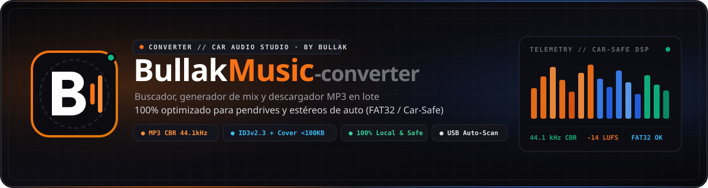
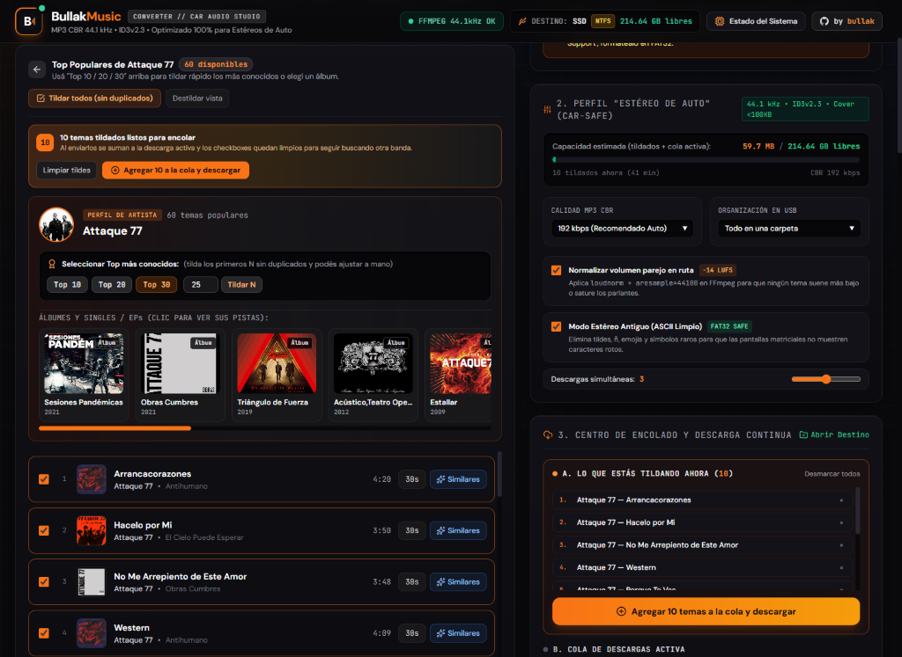
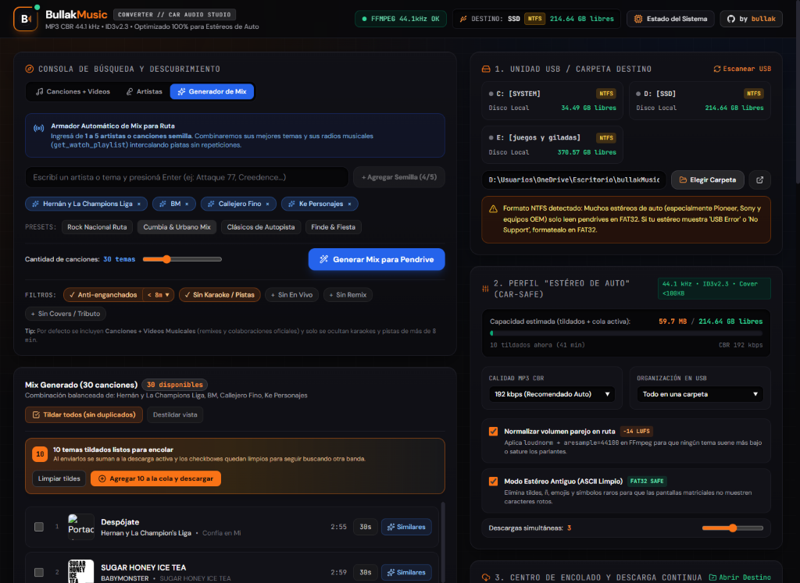
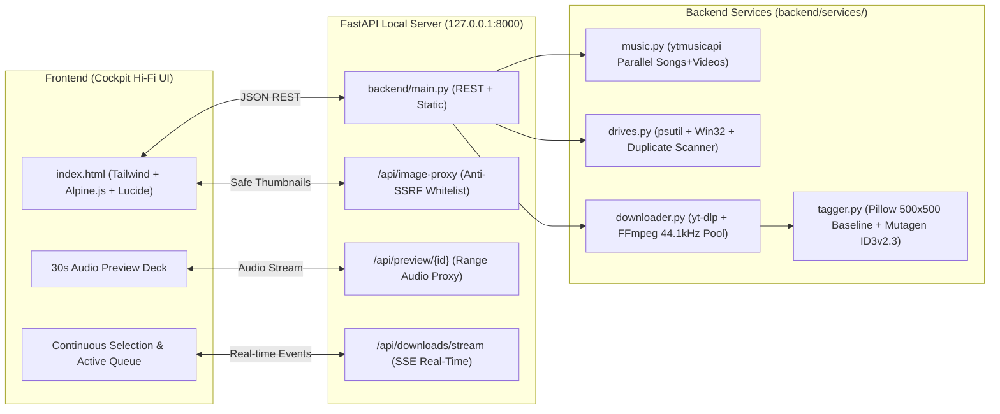

<div align="center">

  <p>
    <a href="README.md"><strong>🇪🇸 Español</strong></a> &nbsp;|&nbsp; <strong>🇺🇸 English</strong>
  </p>

  

  <br />

  <p>
    <a href="https://www.python.org/"></a>
    <a href="https://fastapi.tiangolo.com/"></a>
    <a href="https://github.com/yt-dlp/yt-dlp"></a>
    <a href="https://ffmpeg.org/"></a>
  </p>
  <p>
    <a href="https://github.com/bullak236/BullakMusic-converter"></a>
    <a href="LICENSE"></a>
    
  </p>

  <p>
    <strong>Build car-ready USB flash drives in minutes: no 1-hour megamixes, no shady ad-ridden converter websites, and no more head-unit <code>FILE ERROR</code> or <code>UNSUPPORTED FORMAT</code> screens.</strong><br />
    Search songs, remixes, or full artist discographies, preview 30-second clips, and batch-record continuous queues of <code>44.1 kHz</code> CBR MP3s with EBU R128 loudness normalization and baseline cover art compatible with every car stereo.
  </p>

</div>

---

## 🖼️ Application Screenshots (*Dark Cockpit Hi-Fi UI*)

<div align="center">
  
  <p><em>Artist Profile View: Top 60 popular tracks, one-click <strong>Top 10 / 20 / 30 / N</strong> selector, full albums/singles carousel, and continuous background download center.</em></p>
  <br />
  
  <p><em>Smart Road-Trip Mix Generator (1 to 5 seeds) + independent filter chips (Anti-Long Mixes, No Karaoke, No Live, No Remix, No Covers).</em></p>
</div>

---

## ✨ Key Features

### 1. 🔍 Parallel Combined Search (No Missing Tracks) & Independent Filters
- **Parallel Dual Search (`Songs + Music Videos`):** Queries YouTube Music's official song catalog and music video catalog simultaneously via `ytmusicapi`, ensuring **official remixes, collaborations, live sessions, and recent releases** without album metadata are never missed.
- **5 Independent, Self-Explanatory Filter Chips:**
  - ⏱️ **Anti-Long Mixes (`< 7m / 8m / 9m / 12m / 20m`):** Enabled by default to hide 1-hour continuous DJ sets or compilations.
  - 🎤 **No Karaoke / Backing Tracks:** Enabled by default (toggleable with one click if you want instrumentals).
  - 🎸 **No Live:** Disabled by default so great live performances stay visible; toggle on anytime for studio-only results.
  - 🎧 **No Remix:** Disabled by default so official remixes and collaborations appear right away.
  - 🎭 **No Covers / Tribute:** Disabled by default; toggle on to hide tribute bands and covers.
- **"Similar Tracks" Discovery:** Discover songs from the same genre or vibe from any track card without leaving the screen.

### 2. 🎸 Artist Explorer (`Top 60 + Top N`) & Smart Mix Generator
- **Full Artist Discography:** Loads up to **60 real top popular tracks** per artist alongside a horizontal carousel of their **Albums** and **Singles / EPs**.
- **One-Click `Top 10 / Top 20 / Top 30 / N` Selector:** Check the *N* most popular songs of a band with a single click (automatically skipping tracks already on your USB drive or in the active queue) and fine-tune checkboxes manually before recording.
- **Smart Road-Trip Mix Generator:** Enter **1 to 5 seed artists or songs** + desired track count (`10` to `80`) to build a balanced *Round-Robin* playlist combining radio stations (`get_watch_playlist`).

### 3. ⚡ Continuous Background Download Queue & 30s Audio Preview
- **Continuous Dynamic Queueing (*Append / Enqueue*):** Start downloading one band and immediately search and enqueue the next band without waiting or stopping active downloads. Selection checkboxes auto-clear upon enqueueing, and every track displays live session badges (`↻ In active queue` / `✓ Downloaded`).
- **30-Second CORS-Free Audio Preview:** Floating bottom preview deck with an animated LED equalizer and global `Spacebar` Play/Pause shortcut powered by a clean local streaming proxy (`/api/preview/{video_id}`).

### 4. 🎛️ 100% "Car-Safe" Audio Pipeline & USB Drive Detector
- **Strict `44100 Hz` CBR MP3 Audio:** Converts audio via FFmpeg (`libmp3lame`) to constant bitrate `192 kbps` (recommended) or `320 kbps` at CD-standard `44.1 kHz`.
- **Road-Ready Loudness Normalization (`-14 LUFS`):** Applies EBU R128 normalization chaining `loudnorm=I=-14:TP=-1.5:LRA=11,aresample=44100` + `-ar 44100` (preventing `loudnorm` from upsampling output to `192 kHz`, which causes car stereos to fail).
- **`500x500` Baseline JPEG Cover Art (`< 100 KB`):** Center-crops thumbnails to `500x500` with `Pillow` and encodes them strictly as **Baseline JPEG (`progressive=False`)** under `100 KB` so Pioneer, Sony, Alpine, and OEM screens never freeze.
- **Clean `ID3v2.3` Tags + Legacy Stereo ASCII Mode:** Writes universal `ID3v2.3` frames (`TIT2`, `TPE1`, `TALB`, `TRCK`, `APIC`, `TSSE`) via `mutagen` and strips accents, `ñ`, and emojis using `Unidecode` + `pathvalidate`.
- **3 USB File Organization Modes:**
  - 📁 **Single Folder:** `Artist - Title.mp3`
  - 🗂️ **Artist Subfolders:** `Artist/Artist - Title.mp3`
  - 🔀 **Collision-Free Physical Shuffle (`001..N`):** Prepends unique random numeric prefixes (`007 - Artist - Title.mp3`) across consecutive batches for car stereos with poor built-in *Random* modes.
- **USB Drive Detector & Anti-Duplicate Scanner:** Automatically lists removable USB drives (`psutil` + Win32 API), displays free space in GB, warns if the drive is formatted as `NTFS` or `exFAT` instead of `FAT32`, estimates batch size in real time, and flags existing songs with **`✓ Already in destination`** (even if previously saved with Physical Shuffle prefixes).

---

## 🏗️ Architecture & Technology Stack



### Technology Stack Overview

| Layer | Library / Technology | Purpose & Why It Was Chosen |
| :--- | :--- | :--- |
| **Backend & Streaming** | **Python 3.11+**, **FastAPI**, `uvicorn`, `sse-starlette`, `httpx` | High-performance async server hosting the static UI, REST endpoints, non-blocking audio/image proxies, and real-time download telemetry over **Server-Sent Events (SSE)**. |
| **Music Catalog** | `ytmusicapi` | Unauthenticated YouTube Music catalog queries supporting parallel `songs` + `videos` search, full artist profiles (`Top 60` + albums), and smart radio mixes (`get_watch_playlist`). |
| **Download & Audio DSP** | `yt-dlp[default]` + **FFmpeg** (`libmp3lame`) | Extracts the best audio stream and transcodes it to **192/320 kbps CBR MP3 at `44100 Hz`**, applying EBU R128 loudness normalization (`loudnorm` + `aresample=44100`). |
| **Metadata & Artwork** | `mutagen` + `Pillow` | `Pillow` center-crops thumbnails to `500x500` **Baseline JPEG (`<100 KB`)**; `mutagen` strips incompatible headers and writes strict **ID3v2.3** tags. |
| **Filesystem & USB Drives** | `psutil`, `Unidecode`, `pathvalidate` | Detects removable USB partitions, filesystem format (`FAT32`/`exFAT`/`NTFS`), and free space; sanitizes FAT32 filenames and scans duplicates ignoring Physical Shuffle prefixes. |
| **Frontend (Zero-Node)** | **Tailwind CSS**, **Alpine.js**, **Lucide Icons** | Reactive *Dark Cockpit Hi-Fi* interface served directly by FastAPI so end users can run everything with a single command without installing Node.js. |

---

## 🛡️ Security, Privacy & Transparency (100% Safe)

Online MP3 converters are notorious for malicious pop-ups, bundled adware, and opaque `.exe` installers. **BullakMusic-converter** is built from the ground up for complete transparency and user safety:

- 🔍 **100% Open-Source & Auditable:** No hidden `.exe` binaries, closed libraries, or obfuscated scripts. Every line of Python (`.py`) and HTML/JS is human-readable and open for inspection.
- 🏠 **100% Local Execution (`127.0.0.1:8000`):** The FastAPI server binds exclusively to your local loopback interface (`localhost`). Your searches and audio files never pass through third-party servers.
- 🕵️ **Zero Telemetry, Zero Accounts, Zero Ads:** Requires no login, no cookies, and no personal API keys. It contains zero analytics, trackers, or advertisements.
- 🔒 **Hardened Image Proxy (Anti-SSRF):** The `/api/image-proxy` endpoint strictly enforces `HTTPS` and validates hostnames against an explicit allowlist of official YouTube/Google thumbnail domains (`i.ytimg.com`, `lh3.googleusercontent.com`, `yt3.ggpht.com`), preventing Server-Side Request Forgery.
- 📦 **Isolated Virtual Environment (`.venv`):** The `iniciar.bat` and `iniciar.sh` launchers create and install all dependencies inside a project-local `.venv` folder, leaving your global operating system Python environment untouched.

---

## 🚀 Step-by-Step Guide (Installation & Usage)

### 1. Prerequisites
1. **Python 3.10 or higher** ([Download Python](https://www.python.org/downloads/) — on Windows, make sure to check **"Add Python to PATH"** during installation).
2. **FFmpeg** installed on your system:
   - **Windows (PowerShell / CMD via WinGet):**
     ```powershell
     winget install Gyan.FFmpeg
     ```
   - **Linux (Ubuntu / Debian):**
     ```bash
     sudo apt update && sudo apt install ffmpeg
     ```
   - **macOS (Homebrew):**
     ```bash
     brew install ffmpeg
     ```

### 2. Install & Launch in 3 Steps

1. **Clone the repository** (or download the ZIP via the green `Code` button above):
   ```bash
   git clone https://github.com/bullak236/BullakMusic-converter.git
   cd BullakMusic-converter
   ```
2. **Launch with a single click / command:**
   - **On Windows:** Double-click **`iniciar.bat`**.
   - **On Linux / macOS:**
     ```bash
     chmod +x iniciar.sh
     ./iniciar.sh
     ```
3. **Enjoy!** The launcher automatically creates the `.venv` virtual environment, installs all requirements, starts the local server, and opens your browser at **`http://localhost:8000`**.

---

<details>
<summary><strong>🛠️ Troubleshooting & Car Stereo FAQ (FAT32, FFmpeg, yt-dlp) — Click to expand</strong></summary>

<br />

| Issue | Common Cause | Step-by-Step Fix |
| :--- | :--- | :--- |
| **Car stereo displays `USB ERROR`, `NO SUPPORT`, or `N/A USB` when plugging in the flash drive.** | Most car head-units (Pioneer, Sony, Alpine, OEM) **only read `FAT32` flash drives** (with MBR partition table) and reject `NTFS` or `exFAT`. | 1. Plug your USB drive into your PC (BullakMusic-converter displays its format in the top bar and USB panel).<br />2. If it shows `NTFS` or `exFAT`, back up your files and format the drive as **FAT32** (for 64 GB+ drives on Windows, use free tools like *Rufus* or *GUIFormat* in `FAT32` mode). |
| **Certain tracks show `FILE ERROR`, skip unexpectedly, or freeze the stereo screen.** | The MP3 was encoded at `48000 Hz`, uses `ID3v2.4` tags, or embeds a heavy `WebP` / `Progressive JPEG` cover. | Re-download them with **BullakMusic-converter**: it enforces **`44100 Hz` CBR MP3**, **`500x500` Baseline JPEG (`<100 KB`)** artwork, and clean **`ID3v2.3`** tags. |
| **Stereo display shows garbled symbols (`ñ`, `??`) in song titles.** | Legacy VFD/LCD head-unit firmware only supports basic ASCII characters. | Keep **"Modo Estéreo Antiguo (ASCII Limpio)"** enabled in the Car-Safe profile panel before recording. |
| **The car stereo's *Random / Shuffle* button always repeats the same songs.** | Basic pseudo-random number generator in the car stereo's firmware. | Under **"Organización en USB"**, choose **"Shuffle Físico (`001 - Artista...`)"** to physically randomize file playback order without prefix collisions. |
| **`FALTA FFMPEG` warning appears in the top bar.** | FFmpeg is not installed or the terminal wasn't restarted after installing it. | Run `winget install Gyan.FFmpeg` in a terminal, close `iniciar.bat`, and launch it again. |
| **A download fails after a YouTube player update.** | `yt-dlp` periodically needs updating to match YouTube changes. | Click **"Estado del Sistema"** in the top-right corner of the app and press **"Actualizar motor (yt-dlp)"** for a one-click update. |

</details>

---

## 👤 Author, Contributing & License

- **Author:** Created and maintained by [**bullak**](https://github.com/bullak236)
- **Official Repository:** [github.com/bullak236/BullakMusic-converter](https://github.com/bullak236/BullakMusic-converter)
- **Contributing:** Bug reports, feature ideas, and *Pull Requests* are always welcome! Feel free to open an [Issue on GitHub](https://github.com/bullak236/BullakMusic-converter/issues).
- **License:** Distributed under the **MIT License**. See [LICENSE](LICENSE) for full details.

> **⚖️ Personal & Educational Use Disclaimer:**  
> *BullakMusic-converter is an open-source local tool developed strictly for educational purposes and personal music library organization. It does not host, store, or redistribute copyrighted audio files. Users are solely responsible for complying with applicable terms of service and copyright laws in their jurisdiction.*
