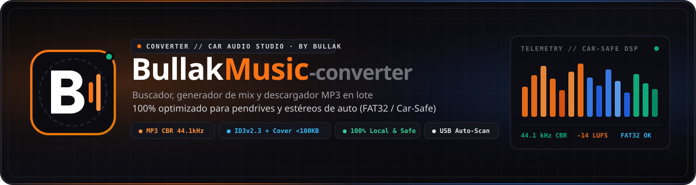
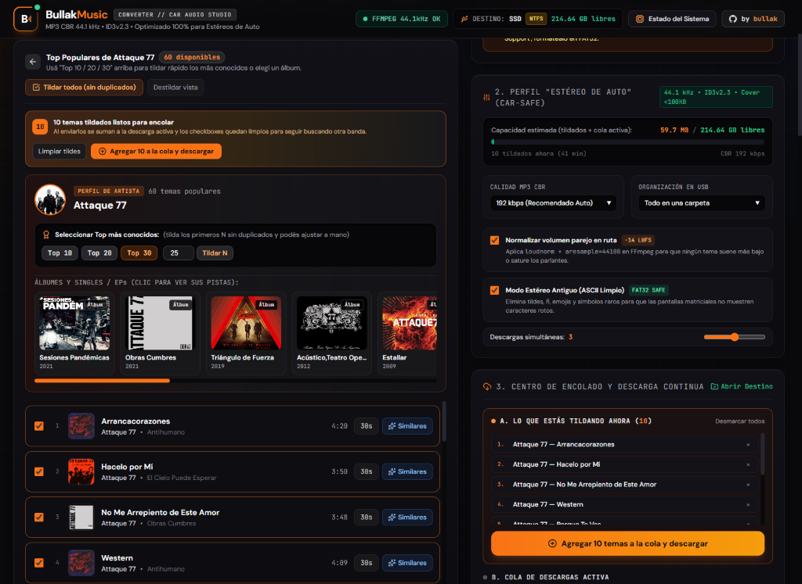
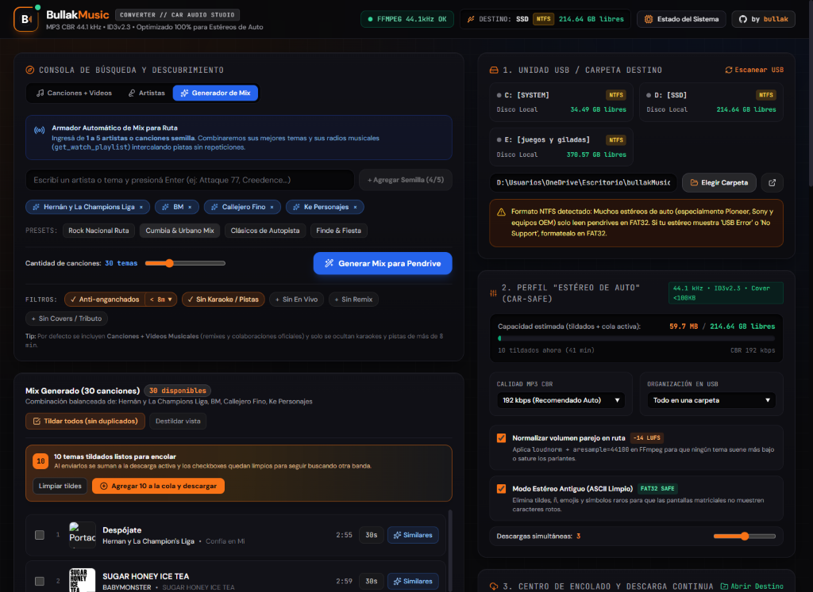
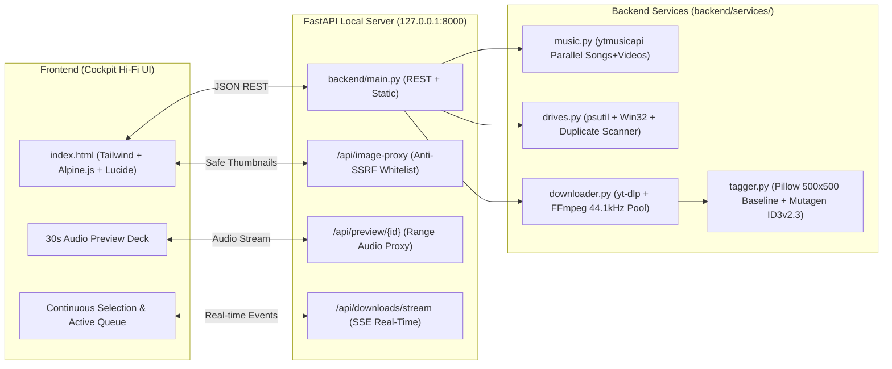

<div align="center">

  <p>
    <strong>🇪🇸 Español</strong> &nbsp;|&nbsp; <a href="README.en.md"><strong>🇺🇸 English</strong></a>
  </p>

  

  <br />

  <p>
    <a href="https://www.python.org/"></a>
    <a href="https://fastapi.tiangolo.com/"></a>
    <a href="https://github.com/yt-dlp/yt-dlp"></a>
    <a href="https://ffmpeg.org/"></a>
  </p>
  <p>
    <a href="https://github.com/bullak236/BullakMusic-converter"></a>
    <a href="LICENSE"></a>
    
  </p>

  <p>
    <strong>Armá pendrives para el auto en minutos: sin enganchados de 1 hora, sin páginas web llenas de anuncios o malware y sin que el estéreo tire <code>FILE ERROR</code> o <code>UNSUPPORTED FORMAT</code>.</strong><br />
    Buscá canciones, remixes o discografías completas, preescuchá 30 segundos y grabá lotes continuos de MP3 CBR a <code>44.1 kHz</code> con volumen normalizado y portadas compatibles con cualquier estéreo.
  </p>

</div>

---

## 🖼️ Capturas de la Aplicación (*Dark Cockpit Hi-Fi UI*)

<div align="center">
  
  <p><em>Vista de Artista: Top 60 temas populares reales, selector rápido <strong>Top 10 / 20 / 30 / N</strong>, álbumes completos y centro de descarga continua.</em></p>
  <br />
  
  <p><em>Generador de Mix Inteligente para Ruta (1 a 5 semillas) + chips de filtros independientes (Anti-enganchados, Sin Karaoke, Sin En Vivo, Sin Remix, Sin Covers).</em></p>
</div>

---

## ✨ Características Principales

### 1. 🔍 Buscador Combinado sin Temas Perdidos & Filtros Independientes
- **Búsqueda Dual en Paralelo (`Canciones + Videos Musicales`):** Consulta simultáneamente el catálogo de canciones oficiales y el de videos musicales de YouTube Music (`ytmusicapi`), asegurando que nunca se pierdan **remixes oficiales, colaboraciones, sesiones en vivo ni lanzamientos recientes** que aún no tienen ficha de álbum.
- **5 Chips de Filtros Independientes y Autoexplicativos:**
  - ⏱️ **Anti-enganchados (`< 7m / 8m / 9m / 12m / 20m`):** Activo por defecto para evitar sets o enganchados de 1 hora.
  - 🎤 **Sin Karaoke / Pistas:** Activo por defecto (desactivable con 1 clic si buscás instrumentales).
  - 🎸 **Sin En Vivo:** Desactivado por defecto para conservar buenas versiones en vivo, activable cuando solo querés estudio.
  - 🎧 **Sin Remix:** Desactivado por defecto para no ocultar colaboraciones ni remixes oficiales.
  - 🎭 **Sin Covers / Tributo:** Desactivado por defecto, activable para filtrar bandas tributo.
- **Botón "Similares":** Descubrí música del mismo género o estilo a partir de cualquier canción sin salir de la pantalla.

### 2. 🎸 Explorador de Artistas (`Top 60 + Top N`) & Generador de Mix
- **Perfil Completo de Artista:** Carga hasta **60 de sus temas más populares reales** junto con el carrusel de todos sus **Álbumes** y **Singles / EPs**.
- **Selector Rápido `Top 10 / Top 20 / Top 30 / N`:** Tildá en un clic los *N* temas más conocidos de una banda (salteando automáticamente los que ya están en tu pendrive o en la cola activa) y ajustalos a mano antes de grabar.
- **Generador de Mix para Ruta:** Ingresá de **1 a 5 artistas o temas semilla** + la cantidad deseada (`10` a `80` canciones) y obtené una lista balanceada en *Round-Robin* combinando radios musicales (`get_watch_playlist`).

### 3. ⚡ Cola de Descargas Continua & Preescucha de 30s
- **Encolado Continuo en Segundo Plano (*Append / Enqueue*):** Mandá a descargar una banda y, sin esperar a que termine, buscá la siguiente y sumala a la cola activa. Los checkboxes se limpian automáticamente al encolar y cada pista muestra su badge en vivo (`↻ En cola activa` / `✓ Descargado`).
- **Previsualización de 30 Segundos sin CORS:** Mini-reproductor flotante inferior con ecualizador LED y atajo de teclado (`Barra espaciadora` para Play/Pausa) mediante streaming asíncrono local (`/api/preview/{video_id}`).

### 4. 🎛️ Pipeline "Estéreo de Auto" (*Car-Safe 100%*) & Detector USB
- **Audio MP3 CBR Estricto a `44100 Hz`:** Conversión con FFmpeg (`libmp3lame`) a `192 kbps` (recomendado) o `320 kbps` CBR.
- **Normalización de Volumen en Ruta (`-14 LUFS`):** Aplica el estándar EBU R128 encadenando `loudnorm=I=-14:TP=-1.5:LRA=11,aresample=44100` + `-ar 44100` (evita que `loudnorm` suba la frecuencia interna a `192 kHz` y rompa la compatibilidad con el estéreo).
- **Portadas `500x500` JPEG Baseline (`< 100 KB`):** Recorte cuadrado centrado con `Pillow` y compresión estrictamente **Baseline (`progressive=False`)** de menos de `100 KB` para no congelar pantallas Pioneer, Sony, Alpine u OEM.
- **Tags `ID3v2.3` Limpios + Modo Estéreo Antiguo (ASCII):** Escribe frames universales (`TIT2`, `TPE1`, `TALB`, `TRCK`, `APIC`, `TSSE`) con `mutagen` y limpia acentos, `ñ` y emojis con `Unidecode` + `pathvalidate`.
- **3 Modos de Organización en USB:**
  - 📁 **Todo en una carpeta:** `Artista - Titulo.mp3`
  - 🗂️ **Subcarpetas por Artista:** `Artista/Artista - Titulo.mp3`
  - 🔀 **Shuffle Físico sin Colisiones (`001..N`):** Antepone prefijos numéricos aleatorios libres (`007 - Artista - Titulo.mp3`) para estéreos con mal modo *Random*.
- **Detector de Pendrives y Escáner Anti-Duplicados:** Detecta unidades USB (`psutil` + Win32 API), muestra espacio libre en GB, alerta si el formato es `NTFS` o `exFAT` en vez de `FAT32`, calcula el peso real del lote en vivo y marca con **`✓ Ya en destino`** las canciones que ya existen en el pendrive (incluso si tienen prefijo numérico de Shuffle Físico).

---

## 🏗️ Arquitectura y Stack Tecnológico



### Tabla del Stack Tecnológico

| Capa | Librería / Tecnología | ¿Qué hace y por qué se eligió? |
| :--- | :--- | :--- |
| **Backend & Streaming** | **Python 3.11+**, **FastAPI**, `uvicorn`, `sse-starlette`, `httpx` | Servidor asíncrono ultrarrápido que sirve el frontend estático, los endpoints REST, el proxy de audio/imágenes sin bloqueos y el progreso en tiempo real mediante **Server-Sent Events (SSE)**. |
| **Catálogo Musical** | `ytmusicapi` | Consulta directa sin autenticación al catálogo de YouTube Music para búsquedas en paralelo (`songs` + `videos`), discografías de artistas (`Top 60` + álbumes) y radios de mix (`get_watch_playlist`). |
| **Descarga y Audio DSP** | `yt-dlp[default]` + **FFmpeg** (`libmp3lame`) | Extrae el mejor stream de audio disponible y lo transcodifica a **MP3 CBR 192/320 kbps a `44100 Hz`**, aplicando normalización EBU R128 (`loudnorm` + `aresample=44100`). |
| **Metadatos y Portadas** | `mutagen` + `Pillow` | `Pillow` recorta las miniaturas a `500x500` y las codifica en **JPEG Baseline (`<100 KB`)**; `mutagen` limpia tags incompatibles y escribe **ID3v2.3** estricto. |
| **Sistema de Archivos y USB** | `psutil`, `Unidecode`, `pathvalidate` | Detecta pendrives extraíbles, formato (`FAT32`/`exFAT`/`NTFS`) y espacio libre; sanitiza rutas para tablas FAT32 antiguas y escanea duplicados ignorando prefijos de Shuffle Físico. |
| **Frontend (Zero-Node)** | **Tailwind CSS**, **Alpine.js**, **Lucide Icons** | Interfaz reactiva con estética *Dark Cockpit Hi-Fi* servida directamente por FastAPI para que el usuario final corra todo con un solo comando sin instalar Node.js. |

---

## 🛡️ Seguridad, Privacidad y Transparencia (100% Seguro)

Sabemos que buscar un descargador de música en internet suele ser sinónimo de páginas llenas de pop-ups engañosos, instaladores `.exe` sospechosos o adware. **BullakMusic-converter** fue diseñado bajo principios estrictos de seguridad y transparencia:

- 🔍 **100% Código Abierto y Auditable:** No incluye ejecutables `.exe` precompilados, binarios cerrados ni código ofuscado. Todo el proyecto es código Python (`.py`) y HTML/JS limpio que podés leer y auditar línea por línea.
- 🏠 **Ejecución 100% Local (`127.0.0.1:8000`):** El servidor FastAPI escucha únicamente en tu interfaz local (`localhost`). Ningún archivo ni búsqueda pasa por servidores intermedios de terceros.
- 🕵️ **Cero Telemetría, Cero Cuentas y Cero Publicidad:** No pide inicio de sesión, no requiere cookies ni API keys de tu cuenta personal, no recopila estadísticas de uso ni incluye rastreadores.
- 🔒 **Proxy de Imágenes Protegido (Anti-SSRF):** El endpoint `/api/image-proxy` valida estrictamente que el esquema sea `HTTPS` y que el dominio pertenezca exclusivamente a la lista blanca oficial de miniaturas de YouTube/Google (`i.ytimg.com`, `lh3.googleusercontent.com`, `yt3.ggpht.com`), bloqueando cualquier intento de *Server-Side Request Forgery*.
- 📦 **Entorno Virtual Aislado (`.venv`):** Los scripts `iniciar.bat` e `iniciar.sh` crean e instalan todas las librerías dentro de una carpeta `.venv` local al proyecto, sin modificar ni ensuciar la instalación global de Python de tu sistema operativo.

---

## 🚀 Guía Paso a Paso (Instalación y Uso)

### 1. Requisitos Previos
1. **Python 3.10 o superior** ([Descargar Python](https://www.python.org/downloads/) — en Windows asegurate de marcar la casilla **"Add Python to PATH"** al instalar).
2. **FFmpeg** instalado en tu sistema:
   - **Windows (PowerShell / CMD con WinGet):**
     ```powershell
     winget install Gyan.FFmpeg
     ```
   - **Linux (Ubuntu / Debian):**
     ```bash
     sudo apt update && sudo apt install ffmpeg
     ```
   - **macOS (Homebrew):**
     ```bash
     brew install ffmpeg
     ```

### 2. Instalación y Arranque en 3 Pasos

1. **Cloná el repositorio** (o descargá el ZIP desde el botón verde `Code` arriba):
   ```bash
   git clone https://github.com/bullak236/BullakMusic-converter.git
   cd BullakMusic-converter
   ```
2. **Iniciá la aplicación con un solo comando:**
   - **En Windows:** Hacé doble clic en **`iniciar.bat`**.
   - **En Linux / macOS:**
     ```bash
     chmod +x iniciar.sh
     ./iniciar.sh
     ```
3. **¡Listo!** El script creará automáticamente el entorno `.venv`, instalará las dependencias, levantará el servidor y abrirá tu navegador en **`http://localhost:8000`**.

---

<details>
<summary><strong>🛠️ Solución de Problemas Frecuentes (Estéreos de Auto, FAT32, FFmpeg y yt-dlp) — Clic para desplegar</strong></summary>

<br />

| Problema | Causa Habitual | Solución paso a paso |
| :--- | :--- | :--- |
| **El estéreo dice `USB ERROR`, `NO SUPPORT` o `N/A USB` al enchufar el pendrive.** | La mayoría de los estéreos de auto (Pioneer, Sony, Alpine, OEM) **solo leen pendrives en formato `FAT32`** (con esquema de partición MBR) y rechazan `NTFS` o `exFAT`. | 1. Conectá el pendrive a tu PC (BullakMusic-converter te mostrará arriba si está en `FAT32`, `NTFS` o `exFAT`).<br />2. Si dice `NTFS` o `exFAT`, hacé copia de tus archivos y formatealo en **FAT32** (en pendrives de 64 GB o más en Windows podés usar herramientas gratuitas como *Rufus* o *GUIFormat* eligiendo `FAT32`). |
| **Algunas canciones dan `FILE ERROR`, se saltean o congelan la pantalla del auto.** | El MP3 fue descargado con otra herramienta a `48000 Hz`, con tags `ID3v2.4` o con una portada `WebP` / `JPEG Progresivo` pesada. | Volvé a descargarlas con **BullakMusic-converter**: convierte todo a **MP3 CBR `44100 Hz`**, recorta la portada a **`500x500` JPEG Baseline (`<100 KB`)** y escribe tags **`ID3v2.3`** puros. |
| **El estéreo muestra signos raros (`ñ`, `??`) en los nombres.** | El display del estéreo solo soporta tabla de caracteres ASCII básica. | Dejá activado el toggle **"Modo Estéreo Antiguo (ASCII Limpio)"** en el panel derecho antes de grabar. |
| **El botón *Random / Shuffle* del auto siempre repite los mismos 10 temas.** | Generador aleatorio limitado en el firmware del estéreo. | En **"Organización en USB"** elegí **"Shuffle Físico (`001 - Artista...`)"**. La app numerará aleatoriamente los archivos sin colisiones para que suenen mezclados de verdad. |
| **Aparece el aviso `FALTA FFMPEG` arriba a la derecha.** | FFmpeg no está instalado o todavía no se reinició la terminal tras instalarlo. | Ejecutá `winget install Gyan.FFmpeg` en una terminal de Windows, cerrá la ventana de `iniciar.bat` y volvé a abrirla. |
| **Una descarga falla porque YouTube actualizó su reproductor.** | `yt-dlp` requiere actualizarse periódicamente para seguir el ritmo de cambios de YouTube. | Hacé clic en **"Estado del Sistema"** arriba a la derecha en la app y pulsá el botón **"Actualizar motor (yt-dlp)"**. Se actualizará solo en segundos. |

</details>

---

## 👤 Autoría, Contribución y Licencia

- **Autor:** Creado y mantenido por [**bullak**](https://github.com/bullak236)
- **Repositorio Oficial:** [github.com/bullak236/BullakMusic-converter](https://github.com/bullak236/BullakMusic-converter)
- **Contribuciones:** ¡Las sugerencias, reportes de bugs y *Pull Requests* son bienvenidos! Podés abrir un ticket en la sección de [Issues](https://github.com/bullak236/BullakMusic-converter/issues).
- **Licencia:** Distribuido bajo la licencia **MIT**. Consultá el archivo [LICENSE](LICENSE) para más detalles.

> **⚖️ Aviso de Uso Personal y Educativo:**  
> *BullakMusic-converter es una herramienta local de código abierto desarrollada con fines estrictamente educativos y de organización musical personal. No aloja, almacena ni redistribuye contenido protegido por derechos de autor. El usuario es responsable de utilizar el software respetando los términos de servicio y las leyes de propiedad intelectual vigentes en su país.*
